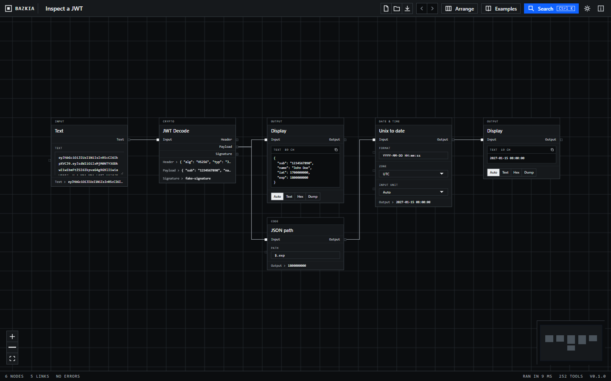

# Bazkia

Small developer tools you wire together on a canvas. Each box is one tool: Base64, a hash, a JWT decoder, a regex. Draw a line from one box to the next and the whole chain recomputes as you type.



**Website and browser version:** https://github.avestura.dev/bazkia/ (the app itself runs at `/app/`)

It runs as a desktop app on Windows, macOS and Linux (Tauri) and in a browser. Nothing is uploaded anywhere; the app makes no network requests of its own.

## What it does

- **Graph of tools.** Drag from an output to an input. Drop a link on empty canvas to add and connect a tool in one go. Cycles are refused.
- **Wire a setting, not only a value.** Every parameter has a small square on its left edge. Link a node into it and the incoming value replaces the control, so an HMAC key can come from another node.
- **252 tools in 17 groups.** Data formats, encodings, hashes, AES and classical ciphers, JWT, TOTP, CRC, regex, CIDR maths, dates, compression, JSON/CSV/XML/SQL tidying, extractors, generators and an auto-decoder called Magic. The full list is searchable on the website and in the app (`Ctrl K`).
- **Live nodes.** Counter, Clock and TOTP run on a timer. Debounce waits until a value stops changing. Random generators have a re-roll button.
- **Undo and redo**, auto-arrange, multi-select, duplicate, minimap, light and dark themes.
- **Projects are plain JSON files.** Save, open, share. The browser version autosaves to local storage.
- **Inspector.** Select a node to see every parameter, its full inputs and outputs as text, hex or hex dump, and how long it took.

### Keyboard

| Keys | Action |
|---|---|
| `Ctrl K` | Search tools and actions |
| `Ctrl Z` / `Ctrl Y` | Undo / redo |
| `Ctrl D` | Duplicate selection |
| `Del` | Delete selection |
| `Ctrl A` | Select all |
| `Ctrl S` / `Ctrl O` | Save / open a project |
| `Space` + drag | Pan (left-drag on empty canvas selects) |

## Relationship to CyberChef

The tool catalogue is modelled on [CyberChef](https://cyberchef.io). Bazkia is not affiliated with it and contains none of its code; every tool here is written from scratch in TypeScript, with [@noble/hashes](https://github.com/paulmillr/noble-hashes) and [fflate](https://github.com/101arrowz/fflate) for hashing and compression and the platform's WebCrypto for AES.

CyberChef has about twice as many operations. Not ported yet: image processing, PGP, RSA and X.509, the Enigma-style cipher machines, protobuf, OCR and YARA. CyberChef's flow-control operations (Fork, Merge, Jump…) have no equivalent because the graph does that job.

Correctness is checked against published test vectors (RFC 4648, 9285, 4231, 4226, 6070, NIST AES, CRC catalogue values) in `src/tools/tools.test.ts`, and every tool is run against empty input with its default settings.

## Download

Installers for Windows, macOS and Linux are on the [releases page](https://github.com/avestura/bazkia/releases/latest). They are not code-signed yet, so Windows SmartScreen and macOS Gatekeeper will ask you to confirm the first launch.

## Build from source

You need Node 22+. For the desktop app you also need Rust and the [Tauri prerequisites](https://tauri.app/start/prerequisites/).

```bash
npm install
npm run dev           # browser, hot reload
npm run tauri dev     # desktop window
npm test              # tool tests (vitest)
npm run check         # Boxy design linter
npm run build         # type-check + production web build
npm run tauri build   # installer for this OS
npm run site:build    # website + browser app into _site/
```

## Adding a tool

Tools live in `src/tools/`. Most are one call to `simple()`:

```ts
simple({
  id: "text:reverse",
  name: "Reverse",
  category: "Text",
  description: "Reverses the text by character, by word or by line.",
  params: [select("by", "By", ["Character", "Word", "Line"])],
  run: (input, p) => /* return a string or Uint8Array */,
})
```

Use `binary()` for two inputs or `tool()` for anything with several outputs. Register the file in `src/tools/index.ts`. The sidebar, palette, website catalogue and the "survives empty input" test all pick it up automatically.

## Releasing

```bash
npm run version:set 0.2.0     # keeps package.json, tauri.conf.json and Cargo.toml in step
git commit -am "chore: release 0.2.0"
git tag v0.2.0 && git push --follow-tags
```

Pushing a `v*` tag runs `.github/workflows/release.yml`, which builds Windows, macOS (Apple silicon and Intel) and Linux installers and attaches them to a GitHub release. Pushes to `main` redeploy the website through `.github/workflows/pages.yml`; `ci.yml` runs the tests, the design check, the web build and `clippy` on every push and pull request.

## Design

The interface follows the [Boxy](https://github.com/avestura/boxy-design-skill) design system: zero radius, hairline borders, hard-offset shadows only, a 4px spacing scale, mechanical motion. The app uses blueprint mode and the website uses editorial mode. `npm run check` runs Boxy's linter over the app and site styles and fails on violations. The skill itself is vendored in `.claude/skills/boxy/` for anyone editing with Claude Code.

## Status

Version 0.x. File formats and tool ids may still change.
